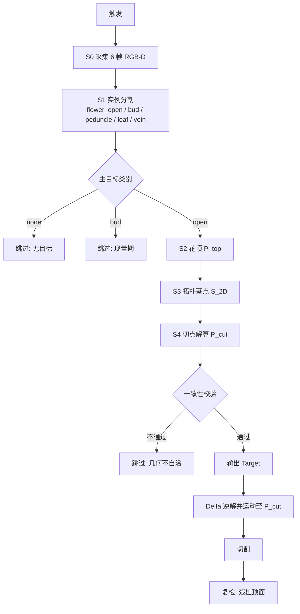

# 视觉核心流程：45° 斜视 + 拓扑茎点

> 单株输入 → 切点输出。本文只描述链路本身。

---

## 1. 输入 / 输出

| 项 | 内容 |
|---|---|
| 输入 | 到位触发信号、6 帧对齐 RGB-D、外参 `R_CV / t_CV`、参数 `h` |
| 输出 | `Target`：花顶 `P_top`、茎点 `S_2D`、切点 `P_cut`、质量标志 |

XY 由茎点决定，Z 由花顶深度决定，两者不互相代入。

---

## 2. 位姿与坐标

相机安装：光心高 `h_c `，距株轴横向偏置 `b `，对花顶俯角 `β = 45°`，工作距离  mm。

```
P_C = K⁻¹·[u, v, 1]·d
P_V = R_CV·P_C + t_CV ,   R_CV = R_install(β)·R_calib
```

`V` 系：`Z_V` 竖直向上，相机光心 `C_V = t_CV`。

---

## 3. 主流程



| 步 | 动作 | 产出 |
|---|---|---|
| S0 | 连拍 6 帧，丢前 2 帧，逐像素取中值 | 稳定的 RGB + 深度 |
| S1 | YOLO11n-seg 实例分割，5 类 | 每目标的 mask |
| S2 | 花冠 mask + 深度，取 `Z_V` 95 分位 | `P_top` |
| S3 | 叶脉骨架拓扑推断茎点像素 | `S_2D = (u_s, v_s)` |
| S4 | `Z_top − h` 定高度，射线与该高度水平面求交 | `P_cut` |
| S5 | 四项一致性校验 | pass / skip |
| S6 | 输出 `Target`，驱动 Delta | — |
| S7 | 切割后复检残桩 | 切中 / 切偏 |

---

## 4. 分步

### 4.1 S1 分割

5 类：`flower_open`（盛开花序）、`flower_bud`（花蕾）、`peduncle`（花序柄）、`leaf`（叶片/冠层）、`vein`（叶脉）。

推理参数：`imgsz=960, conf=0.6, iou=0.5, retina_masks=True`。

### 4.2 S2 花顶

```
D_top = { d(u,v) | (u,v) ∈ flower_open mask, d 有效 }
Z_top = percentile(D_top → Z_V, 95)
P_top = (x, y, Z_top)
```

`P_top` 只用 Z。XY 不参与切点计算。

### 4.3 S3 拓扑茎点

```
1. vein 实例按质心落入哪个 leaf 多边形，归属到该叶片
2. vein ∩ leaf → 填洞 → 开运算 → 闭运算 → 只留最大连通域
3. 骨架化 → 取端点 → 距叶片质心更近的端点 = 近端
4. 近端起前 30% 骨架点做 SVD 主轴 → 叶脉趋势线
5. 同一冠层内趋势线两两求交 → 候选点
6. 保留落在冠层多边形内、且在近端点最小外接圆内的候选
7. 候选 > 3 时，迭代剔除离虚拟中心最远的点至剩 3 个 → 取均值
```

结果 `S_2D` 是**二维像素点**，不取该像素的深度值。

兜底：拓扑点不足（候选 < 2）时，取 `peduncle` mask 最下端像素作为 `S_2D`。仍失败则跳过。

### 4.4 切点解算

```
Z_cut = Z_top − h
r_V   = normalize(R_CV·K⁻¹·[u_s, v_s, 1])
t     = (Z_cut − C_V,z) / r_V,z
P_cut = (C_V,x + t·r_V,x , C_V,y + t·r_V,y , Z_cut)
```

即：茎点像素确定一条射线，射线与高度 `Z_cut` 的水平面相交，交点就是切点。

该点落在茎的可见侧面，沿射线偏出约半个茎径（≈8 mm），在刀盘 ±30 mm 冗余内，不做补偿。

### 4.5 一致性校验

| 校验 | 判据 | 不通过 |
|---|---|---|
| 茎轴倾角 | `û` 与 `+Z_V` 夹角 ≤ 10° | 跳过 |
| 裸茎长度 | `L_vis ≥ h + 30 mm` | 跳过 |
| 茎点 / 柄一致性 | 拓扑茎点与花序柄下端的 2D 偏差 ≤ 25 px | 跳过 |
| 花头深度有效率 | `flower_open` mask 内有效深度 ≥ 60% | 跳过 |
| 多帧一致性 | 连续 3 帧 `P_cut` 互差 ≤ 10 mm | 重拍一次 |

`û` 由 `peduncle` mask 的点云 PCA 主轴拟合，仅用于上述倾角校验，不参与 `P_cut` 计算。

### 4.6 输出

```python
Target = {
    "cls": "open", "conf": 0.91,
    "top_xyz": (x, y, Z_top),
    "stem_uv": (u_s, v_s),
    "cut_xyz": (X_cut, Y_cut, Z_cut),
    "quality": {
        "depth_valid_ratio": 0.87,
        "axis_tilt_deg": 2.1,
        "visible_stalk_mm": 182.0,
        "frames_hit": 5,
    },
    "t": 1730000000.123,
}
```

---

## 5. 切割后预期点位

切割完成后，刀盘应留下一个残桩，其顶面中心即预期点位：

```
P_expect = (X_cut, Y_cut, Z_cut)
```

复检内容：

| 项 | 预期 | 判据 |
|---|---|---|
| 花冠 | 从视野中消失 | `flower_open` mask 面积 → 0 |
| 残桩顶面中心 | 落在 `P_expect` | XY 偏差 ≤ 10 mm |
| 残桩顶面高度 | `Z_cut` | Z 偏差 ≤ 10 mm |
| 顶面形态 | 水平截面，法向 ≈ `+Z_V` | 截面内点云拟合平面倾角 ≤ 15° |

任一项不满足：记为「未切中茎」或「切偏」，不进重试，直接上报。
